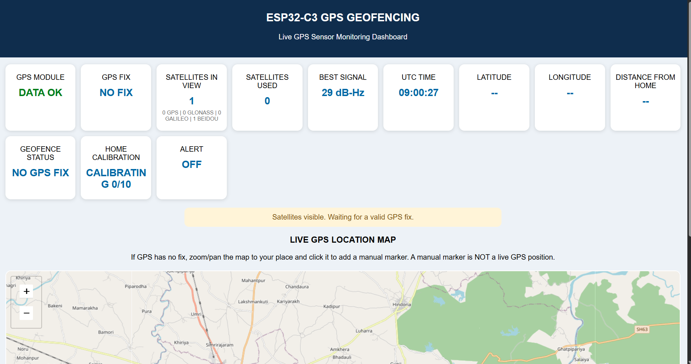

# ESP32-C3 Real-Time GPS Geofencing & Live Web Dashboard

A standalone IoT-based geofencing and asset-tracking system built using the **ESP32-C3**. The project features a custom raw NMEA parser, a spherical Haversine distance engine, hysteresis-based boundary protection, and an interactive **Leaflet.js** web dashboard for real-time GPS monitoring.

WORKING DEMO: ()

## Key Features

- **Custom Zero-Library NMEA Parser:** Parses `$GGA` and `$GSV` sentences directly through Hardware UART at `9600` baud, with hexadecimal XOR checksum verification.
- **Multi-Constellation Satellite Tracking:** Monitors satellites in view, active satellite locks, and maximum signal strength (SNR in `dB-Hz`) across GPS, GLONASS, Galileo, and BeiDou.
- **Haversine-Based Geofencing with Hysteresis:** Calculates real-time distance from a calibrated or preset home coordinate. Uses a `30m` outer trigger radius and a `27m` inner clear radius to minimize false alarms caused by GPS drift.
- **Dual-Mode Wi-Fi (STA + SoftAP Fallback):** Connects to an existing Wi-Fi network or automatically launches an `ESP32_GPS_DASHBOARD` hotspot at `192.168.4.1`.
- **Interactive Leaflet.js Map:** Supports live GPS coordinate plotting, OpenStreetMap Nominatim landmark searches, and manual coordinate injection through the `/setcoords` endpoint for indoor testing and simulation.

## Hardware Requirements

The following hardware components are used to develop the ESP32-C3-based real-time GPS geofencing and asset-tracking system.

| No. | Hardware Component | Purpose |
|:---:|---|---|
| 1 | **ESP32-C3 Development Board** | Main microcontroller responsible for GPS data processing, Wi-Fi connectivity, and web server hosting. |
| 2 | **GPS Module (UART-based)** | Receives real-time GPS coordinates, satellite information, and NMEA data. |
| 3 | **Active Buzzer** | Provides an audible alert when the device detects a geofence boundary violation. |
| 4 | **USB Type-C Cable** | Supplies power to the ESP32-C3 and enables programming and serial communication. |
| 5 | **Jumper Wires** | Connects the GPS module and buzzer to the ESP32-C3 GPIO pins. |

## Hardware Pin Connections

| Component | ESP32-C3 GPIO | Connection |
|---|:---:|---|
| GPS TX | GPIO 2 | ESP32-C3 RX |
| GPS RX | GPIO 3 | ESP32-C3 TX |
| Buzzer Signal | GPIO 4 | Digital Output |
| GPS VCC | 3.3V / 5V | According to GPS module specifications |
| GPS GND | GND | Common Ground |
| Buzzer GND | GND | Common Ground |

## Communication Settings

- **GPS Module Baud Rate:** `9600`
- **Serial Monitor Baud Rate:** `115200`
- **GPS Protocol:** NMEA 0183
- **GPS UART Configuration:** `9600, 8N1`

## Quick Start

1. Clone or download this repository.
2. Open `esp32-c3-gps-geofencing.ino` in the **Arduino IDE**.
3. Select **ESP32C3 Dev Module** under `Tools → Board`.
4. Configure your Wi-Fi credentials by updating `WIFI_SSID` and `WIFI_PASSWORD` in the sketch.
5. Connect the GPS module according to the hardware pinout.
6. Connect the ESP32-C3 to your computer using a USB Type-C cable.
7. Select the correct COM port and upload the sketch.
8. Open the **Serial Monitor** at `115200` baud to view GPS diagnostics and the dashboard IP address.
9. Open the displayed IP address in a web browser to access the live GPS dashboard.

**Note:** If the ESP32-C3 cannot connect to the configured Wi-Fi network, it automatically switches to SoftAP mode. Connect to the `ESP32_GPS_DASHBOARD` Wi-Fi hotspot and navigate to `http://192.168.4.1`.

## Software & Technologies

- **Arduino IDE** – Microcontroller programming and firmware development.
- **C/C++** – Embedded programming for ESP32-C3.
- **HardwareSerial (UART)** – GPS module communication.
- **NMEA 0183** – GPS data format and satellite information.
- **Haversine Formula** – Spherical distance calculation for geofencing.
- **HTML, CSS & JavaScript** – Web dashboard development.
- **Leaflet.js** – Interactive GPS mapping.
- **OpenStreetMap** – Map tiles and geographical visualization.
- **Nominatim API** – Landmark and location search.

## Contributors

1. **Aadi Gautam**
2. **Manvi Gola**
